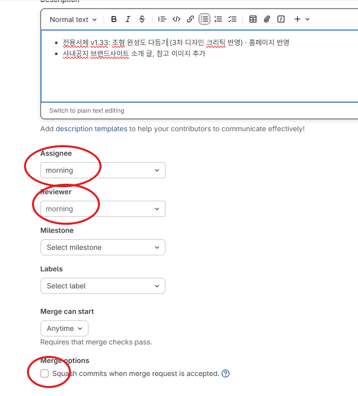
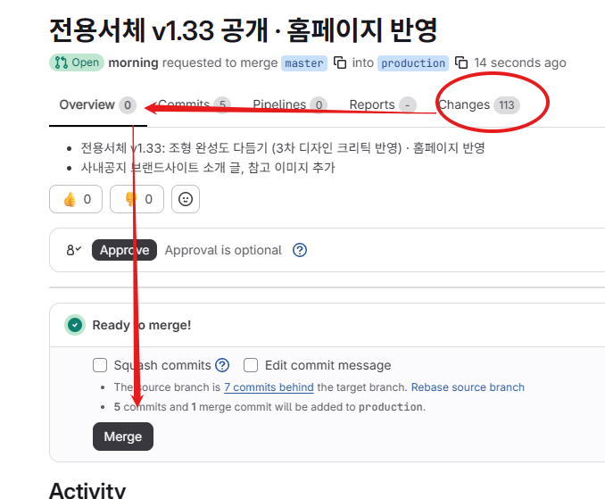

# 깃랩 MR 순서 — master 에서 production 으로 합치기

> 2026-11-09 회사 PC에서 처음 한 과정을 정리했다. 다음에 이 순서대로 하면 된다.
> MR(Merge Request): 깃랩에서 "이 갈래를 저 갈래에 합쳐 주세요" 하고 요청하는 것. 깃허브의 PR과 같다.

## 먼저 알아 둘 것
- **production 갈래는 깃랩에만 있다.** 깃허브에는 master 뿐이라 깃허브 PR 이 아니라 깃랩 MR 로 한다.
- 저장소 주소
  - 깃랩: https://igit.fnguide.com/design/brand-design-management
  - 깃허브: https://github.com/morningjh-cpu/FnGuide-Brand-Identity
- 이 저장소의 `gitlab` 원격(연결 이름)은 push 하면 깃랩·깃허브 두 곳으로 같이 간다.
- 갈래: `develop` · `master` · `pre-production` · `production` (깃랩 기준)

## 순서

### 1. 올릴 것을 먼저 커밋·push
Claude 에게 "cmt" 라고 하면 커밋하고 깃허브·깃랩 두 곳에 올린다. 결과를 따로 알려 준다(예: "깃허브 성공, 깃랩 성공").

### 2. 합칠 내용 확인
```
git fetch --all
git log --oneline gitlab/production..master          # production 에 새로 들어갈 커밋 목록
git merge-tree --write-tree gitlab/production master  # 오류 없이 끝나면 "충돌 없음"
```
- 2026-11-09 에는 새로 들어갈 커밋 5개, 충돌 없음이었다.

### 3. MR 만들기 화면 열기
크롬으로 아래 주소를 연다(보내는 갈래 master, 받는 갈래 production 이 미리 골라져 있다).
```
https://igit.fnguide.com/design/brand-design-management/-/merge_requests/new?merge_request%5Bsource_branch%5D=master&merge_request%5Btarget_branch%5D=production
```
Windows PowerShell 에서 바로 열기:
```
Start-Process chrome 'https://igit.fnguide.com/design/brand-design-management/-/merge_requests/new?merge_request%5Bsource_branch%5D=master&merge_request%5Btarget_branch%5D=production'
```

### 4. 제목·설명 쓰고 만들기
- 제목: 이번에 바뀐 것을 한 줄로 (예: `전용서체 v1.33 공개 · 홈페이지 반영`)
- 설명: 2번에서 본 커밋 목록을 짧게 정리
- 맨 아래 **Create merge request** 단추를 누른다.

## 해 봤는데 안 된 것 (다시 시도하지 않아도 됨)
- **glab(깃랩 명령 도구)으로 MR 자동 만들기**: glab 1.128.0 은 설치했다(winget, `~/AppData/Local/Programs/glab/`).
  하지만 로그인에 필요한 개인 접근 토큰 화면이 회사 깃랩에서 404 로 나왔다
  (`/-/user_settings/personal_access_tokens`, `/-/profile/personal_access_tokens` 둘 다).
  회사가 토큰 기능을 막아 둔 것으로 보인다(추측). 쓰려면 깃랩 관리자에게 먼저 물어야 한다.

## 다음에 시험해 볼 것 (아직 확인 안 됨)
- 새 커밋을 깃랩에 올릴 때 MR 도 같이 만들기 — 토큰 없이 지금 git 로그인으로 된다:
  ```
  git push gitlab master -o merge_request.create -o merge_request.target=production -o merge_request.title="제목"
  ```
  - 새로 올릴 커밋이 있을 때만 작동한다. 이미 다 올라간 상태면 3번 방법(화면 열기)을 쓴다.
  - 회사 깃랩에서 실제로 되는지는 아직 모른다. 처음 써 보면 결과를 이 문서에 적는다.


왼쪽 하단 Master로 된 것을 디벨로퍼로 변경하기 (지금은 내 작업물이 마스터이므로 확인만)  
  
디벨로퍼 -> 마스터 -> 프로덕션  
  
클로드에게 다음 요청  
"마스터에서 프로덕션으로 PR 해줘"  
  
깃랩 화면  
클로드에 나온 변경사항 들을  "제목" "설명"에 복사 붙여넣기 한다.  
- 어싸이니 -> "어싸이니 투 미" 클릭  
- 리뷰어 -> morning  선택  

"마스터에서 프로덕션으로 PR 해줘. 변경사항과 제목은 채워줘"  
  
  

  
하단에 머지 옵션은 체크 해제 상태에서 Create Merge Request 버튼 클릭  
  
페이지가 변경되면, Change 탭에서 변경사항들을 확인해본다.  
바뀐내용 확인한 후 Overview 탭에서 (체크박스 언체크 상태에서 Merge 클릭)  
  
  
  
  

클로드에게   
마스터에 있는 것과 디벨롭 또는 내 PC와 다른 것이 있는지 체크해달라고 한 후에 없으면 진행하고  
있다면 바꿔달라고 요청한다. 


